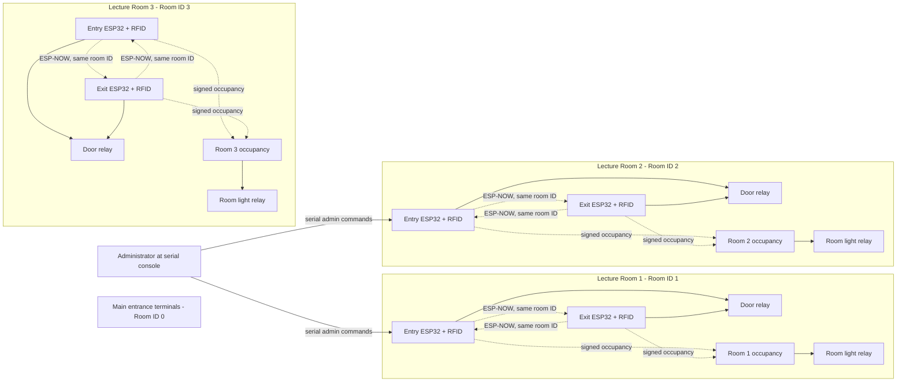
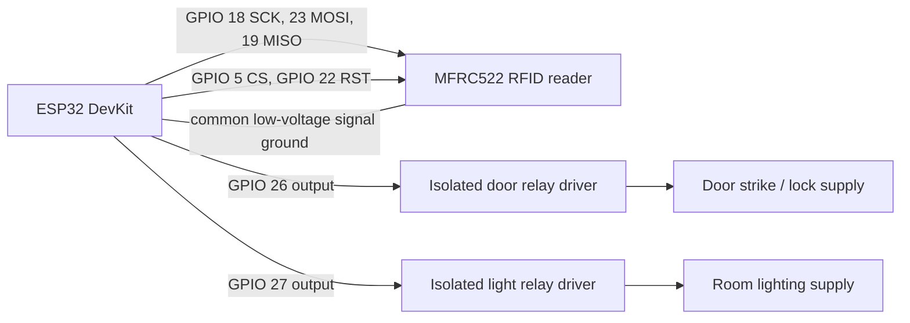

# Room Map and System Diagrams

The assignment text identifies Lecture Room 1, Lecture Room 2, Lecture Room 3, and the main entrance, but provides no architectural floor plan. These are logical room assignments, not a measured building layout. Replace the illustrative room labels/positions with the approved CCIS floor plan before installation.

## Logical room map

```text
CCIS BUILDING
┌────────────────────┐  ┌────────────────────┐  ┌────────────────────┐
│ Lecture Room 1     │  │ Lecture Room 2     │  │ Lecture Room 3     │
│ Room ID 1          │  │ Room ID 2          │  │ Room ID 3          │
│ Entry + Exit RFID  │  │ Entry + Exit RFID  │  │ Entry + Exit RFID  │
│ ESP32 / light relay│  │ ESP32 / light relay│  │ ESP32 / light relay│
└────────────────────┘  └────────────────────┘  └────────────────────┘
             Main Entrance: Room ID 0, separate perimeter access terminals
```

## System topology



Each ESP32 broadcasts a signed count with its room ID. A terminal aggregates only matching room IDs, so room lighting is based on that room's entry/exit count rather than the whole building. The pictured main-entrance node is a separate access zone; it does not determine which lecture room a visitor enters.

## Room-terminal wiring



Use the GPIO defaults in `main/main.c` only after checking the exact board and module pinout. Relay outputs are active-high in this prototype. Do not connect a door strike, mains voltage, or other high-current load directly to an ESP32 GPIO.