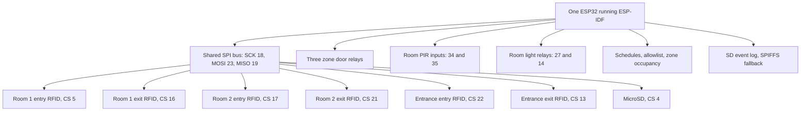
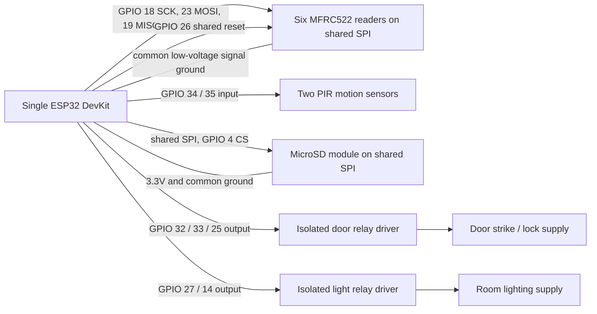

# Room Map and System Diagrams

The assignment pilot covers Lecture Room 1, Lecture Room 2, and the main entrance. This implementation uses one central ESP32 for all three zones. The assignment does not provide an architectural floor plan, so the layout is logical rather than measured. Replace the illustrative labels/positions with the approved CCIS floor plan before installation.

## Single-controller pilot layout

```text
                  ONE ESP32 CONTROLLER
       ┌──────────┬──────────┬────────────┐
       │          │          │            │
  Room 1 entry/exit  Room 2 entry/exit  Entrance entry/exit
  RFID x2 + PIR      RFID x2 + PIR      RFID x2
  door + light       door + light       door relay
```

## System topology



All six RFID readers share one SPI bus and have individual chip-select lines. The firmware polls each reader and updates the Room 1, Room 2, or entrance zone count locally; no ESP-NOW link or extra ESP32 is required. Door unlock pulses use deadlines rather than blocking delays, so the controller continues polling other readers while a door is open. The serial status calls occupancy values estimates because missed scans, duplicate scans, or tailgating can cause drift. PIR sensors control room lighting with a 30-second motion hold; PIR detects motion, not people. Configuration and zone counts are stored in NVS. Event logs use a FAT-formatted microSD card at `/sdcard/events.csv`, with SPIFFS as fallback.

## One-controller pin map

| Function | GPIO |
| --- | --- |
| Shared RFID/SD SPI SCK / MOSI / MISO | 18 / 23 / 19 |
| RFID chip select: R1 entry / R1 exit | 5 / 16 |
| RFID chip select: R2 entry / R2 exit | 17 / 21 |
| RFID chip select: entrance entry / exit | 22 / 13 |
| Shared RFID reset | 26 |
| SD card chip select | 4 |
| Room 1 / Room 2 PIR output | 34 / 35 |
| Room 1 / Room 2 light relay | 27 / 14 |
| Room 1 / Room 2 / entrance door relay | 32 / 33 / 25 |

GPIO 4 and GPIO 5 are ESP32 boot-strapping pins used for the SD and first RFID chip select; ensure the modules do not force incompatible levels during reset. All modules need a common ground, and the RFID/SPI signal levels must be compatible with 3.3V. The configured schedule denies entry outside the access window but never denies an authorized exit scan. Keep a code-independent emergency-egress mechanism on any real door.

## Serial demonstration

The serial console supports `help`, `status`, `logs`, `login <PIN>`, `logout`, `allow <8-hex-UID>`, `deny <8-hex-UID>`, `schedule <HH:MM> <HH:MM>`, `time <YYYY-MM-DD> <HH:MM:SS>`, and `pin <new-PIN>`. Configuration changes require an administrator login. Change the prototype default PIN (`1234`) during setup. Schedules are same-day ranges. When the clock is unset, entry is denied; an authorized exit scan remains permitted.

The Wokwi diagram is a wiring reference, not a fully validated six-reader simulation. Verify that the simulator models multiple RC522 devices on a shared SPI bus and that the SD card mounts; if the simulator cannot model the complete bus, demonstrate the full behavior on hardware or document a reduced Wokwi simulation with the same firmware architecture.

## Room-terminal wiring



Use the GPIO assignments only after checking the exact board and module pinout. Format the SD card as FAT/FAT32 before use; firmware does not automatically format a card on mount failure. Relay outputs are active-high in this prototype. Do not connect a door strike, mains voltage, or other high-current load directly to an ESP32 GPIO.