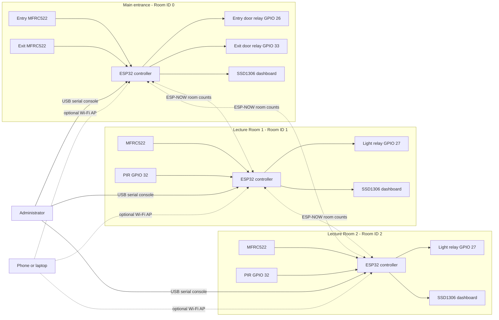
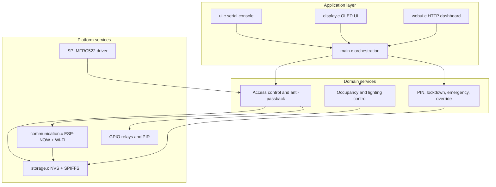
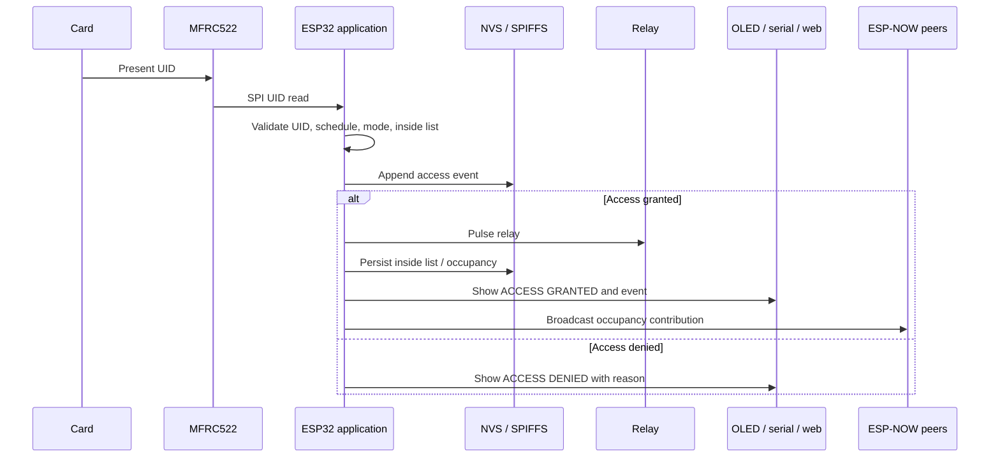
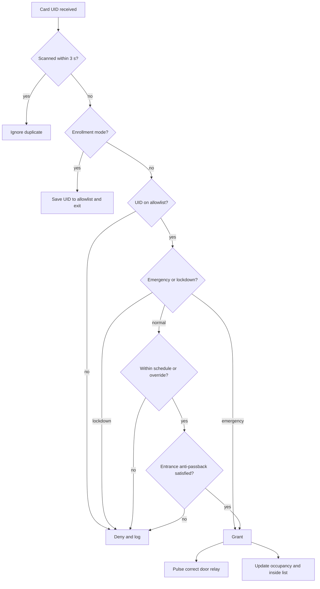
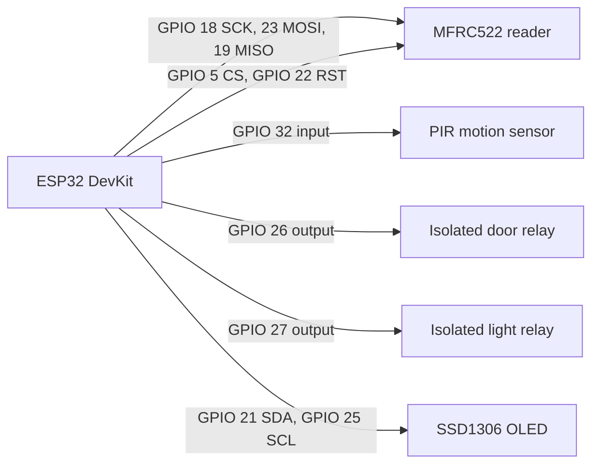
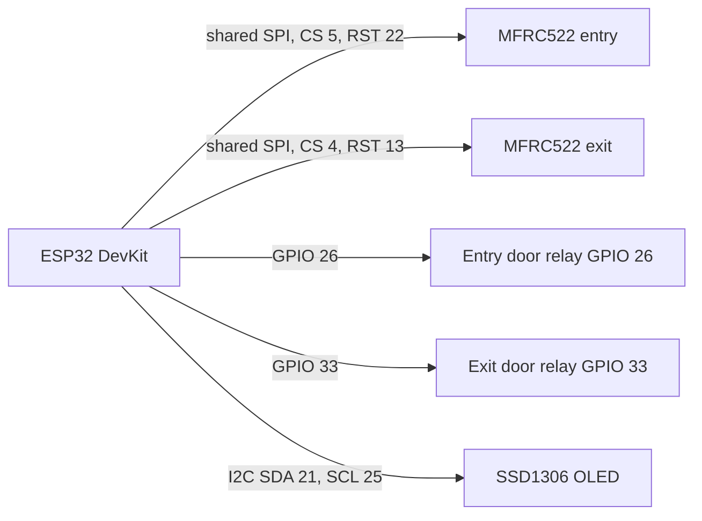
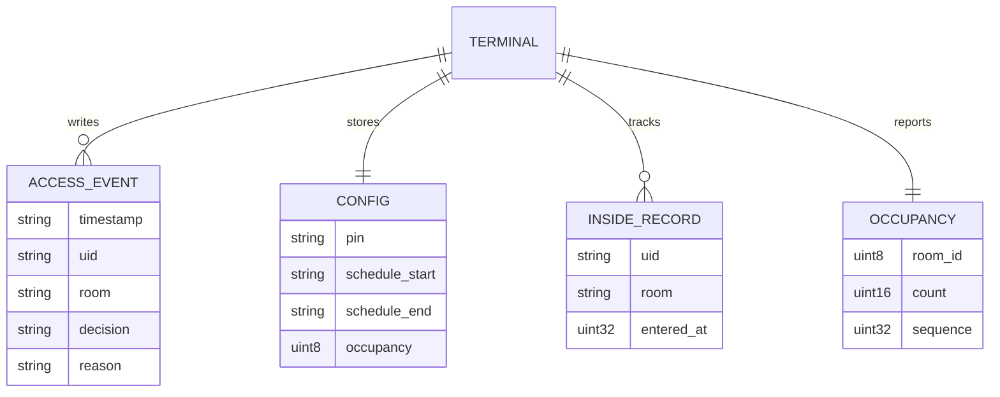

# System Architecture and Diagrams

The pilot covers the CoCIS main entrance and two lecture rooms. No architectural
floor plan was supplied, so the room positions below are logical, not measured.
Replace them with the approved CoCIS layout before installation.

## Logical layout

```text
COCIS BUILDING
┌──────────────────────┐      ┌──────────────────────┐
│ Lecture Room 1       │      │ Lecture Room 2       │
│ Room ID 1            │      │ Room ID 2            │
│ RFID + PIR + light   │      │ RFID + PIR + light   │
│ OLED + serial + web  │      │ OLED + serial + web  │
└──────────┬───────────┘      └──────────┬───────────┘
           │        ESP-NOW occupancy    │
           └──────────────┬──────────────┘
                          │
                ┌─────────┴──────────┐
                │ Main entrance      │
                │ Room ID 0          │
                │ Entry + exit RFID  │
                │ Two door relays    │
                │ OLED + serial + web│
                └────────────────────┘
```

Each terminal is a self-contained ESP32 node. The entrance has both entry and exit
readers on one controller; each room has one reader for access and a PIR sensor for
lighting.

## Node topology



The web dashboard is optional and disabled by default. Enable it per terminal with
`CONFIG_SMART_SYSTEM_ENABLE_WEB`; the node then starts a SoftAP and serves the
dashboard at `http://192.168.4.1`.

## Component view



`main.c` owns the shared state and a FreeRTOS mutex. The UI modules never touch
hardware directly; they read snapshots produced by the application layer.

## Card-scan sequence



## Access decision logic



The entrance checks the inside list: a card already inside cannot enter again, and
a card not inside cannot exit. Lecture rooms do not use anti-passback because they
have a single reader.

## Room-terminal wiring



## Main-entrance wiring



Both readers share SCK, MOSI, and MISO but have independent chip-select and reset
lines. The relays are active-high and must drive an isolated door-strike circuit.
Never connect a strike or mains voltage directly to an ESP32 pin.

## Data model



`CONFIG` and `INSIDE_RECORD` live in NVS. `ACCESS_EVENT` is appended to
`/spiffs/events.csv`. Occupancy is persisted in NVS and also broadcast over ESP-NOW.
